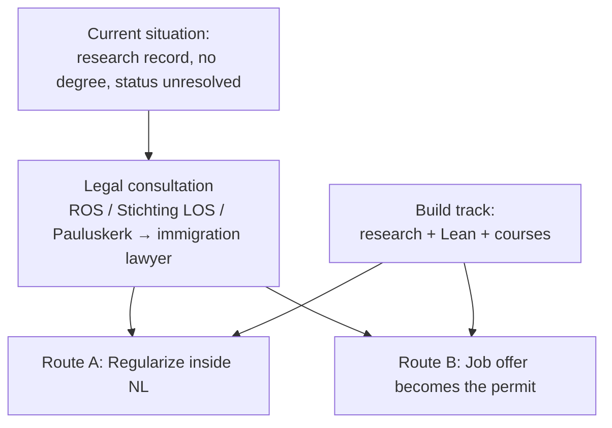
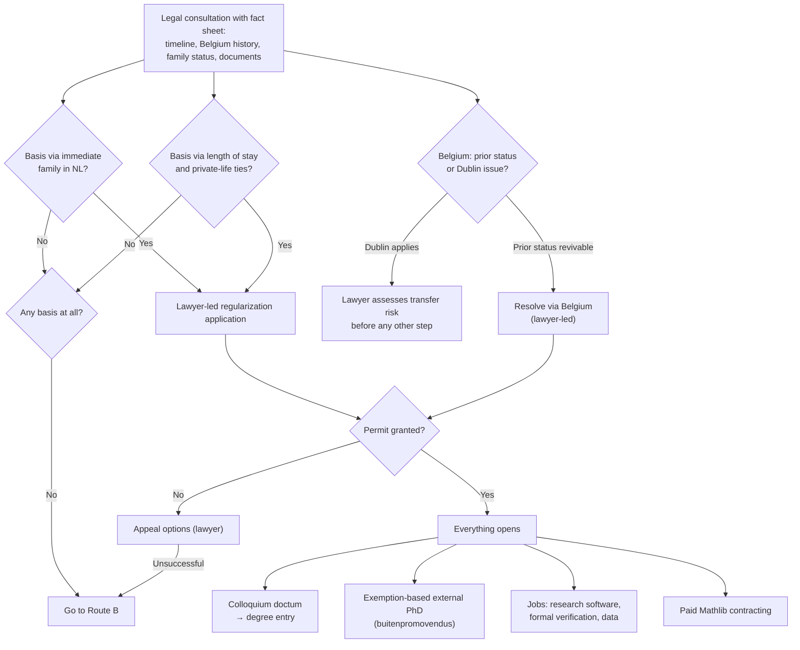
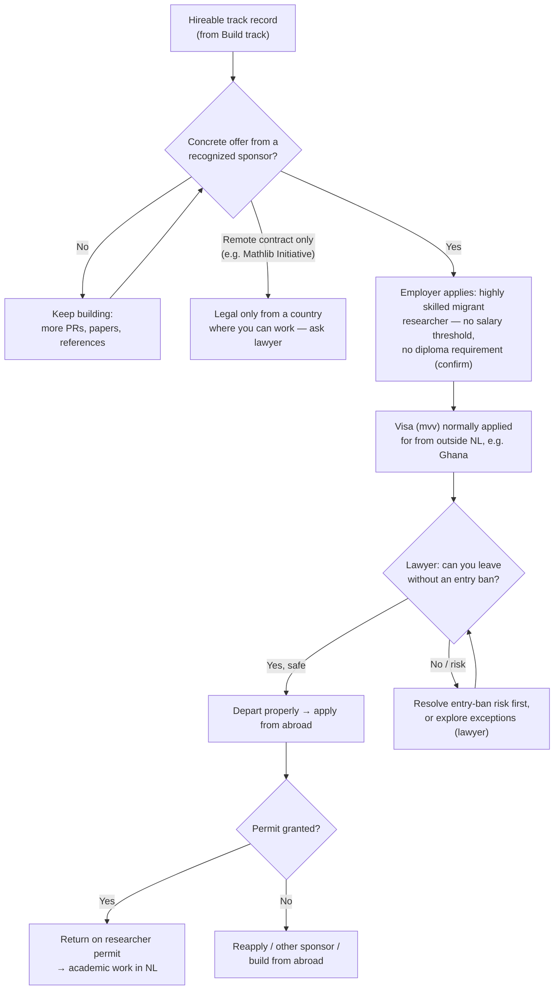
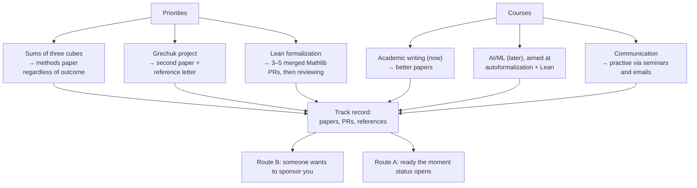

An interesting book on Mathematics for Machine Learning I found [here](https://mml-book.github.io/book/mml-book.pdf). Must read! 

A paper from SR Dahmen that's a must-read is [this](https://arxiv.org/pdf/2209.15492) and [that](https://dspace.library.uu.nl/server/api/core/bitstreams/c0f6921b-b13d-4bdb-aeab-7dc314d0b4d5/content).

A website for Quants: [see](https://quantmemo.com/learn).

A great website for academics: [here](https://researcheracademy.elsevier.com).

# Path Forward — Decision Trees

> Legal points are questions for an immigration lawyer, not conclusions.

## Overview

## Route A — Regularize from inside the Netherlands

## Route B — A job offer becomes the permit

## Build Track — what feeds both routes

